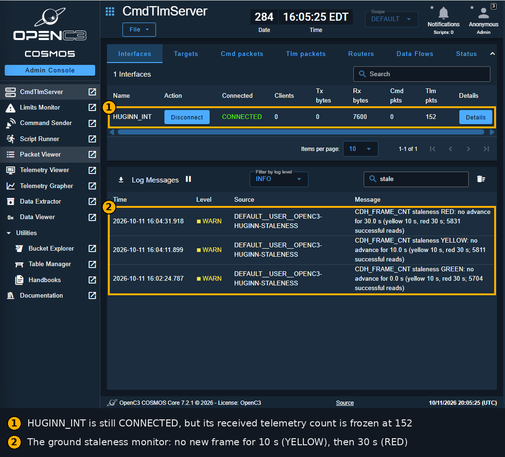
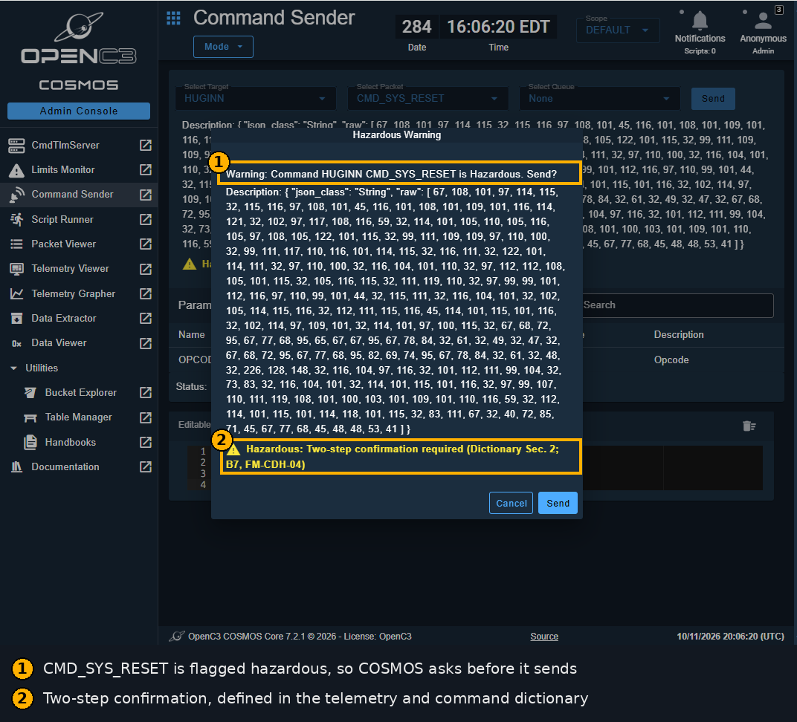
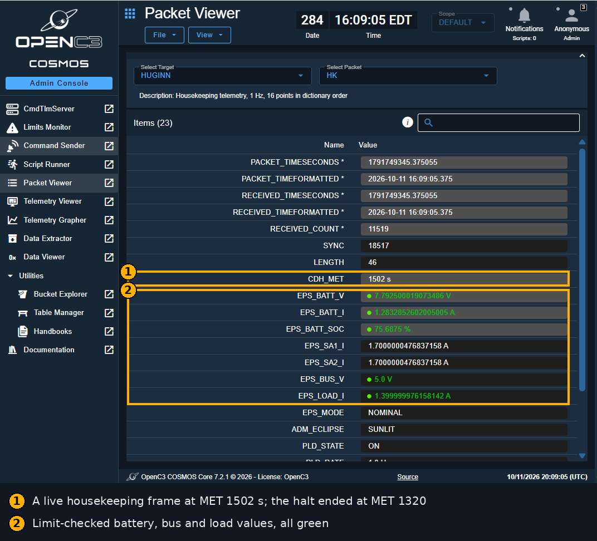

# HUGINN: CubeSat Mission Operations Simulator

[](https://github.com/dan-lee-odinson/huginn/actions/workflows/checks.yml)

A mission operations simulator for a fictional 6U CubeSat, by **Dan Lee-Odinson**.

The spacecraft is simulated in Python, and I operate it by written procedure through a
mission campaign, against real ground software: OpenC3 COSMOS. This repository holds the
complete systems-engineering record behind it, from stakeholder needs through requirements,
FMEA and procedures to the reports of the passes I flew.

The spacecraft and its mission are fictional, and its model is simplified. This release is a
training simulator, and the starting point for HUGINN's flight version under Project AESIR.

In Norse myth, Odin flies two ravens over the world: **Huginn** (thought) and **Muninn**
(memory). [MUNINN](https://github.com/dan-lee-odinson/muninn), my mission-ops vocabulary
trainer, is the memory raven. HUGINN is the thought raven, where that vocabulary goes to work
at a console: flying a spacecraft by procedure through nominal and anomaly passes.

## Status

Version 0.1.5. The design record went through the HUG-G001 adversarial review series, which
I closed as Director, and I flew the four-pass campaign between August and October 2026.

| Pass | Record | Fault | Outcome |
|---|---|---|---|
| PASS-1 | `2026-09-13-P1` | none, nominal payload activation | all 18 steps completed |
| PASS-2 | `2026-09-20-P2a`, `2026-09-20-P2b` | solar-array string loss, over two contacts | payload shed; anomaly report AR-001 |
| PASS-3 | `2026-10-11-P3` | stuck-on load | payload shed; anomaly report AR-002 |
| PASS-4 | `2026-10-11-P4` | housekeeping telemetry generation halt | telemetry restored; anomaly report AR-003 |

`2026-08-03-P1` is my first PASS-1 attempt, kept as filed with its recorded omission;
`2026-09-13-P1` re-executes it. The first attempt fails the current validator, and
[its folder note](docs/pass_reports/2026-08-03-P1/README.md) says why. Pass reports are in
`docs/pass_reports/`, anomaly reports in `docs/anomalies/`, and
`tools/pass_report.py --validate` checks any of them against its procedure.

## PASS-4 at the console

PASS-4's fault halts housekeeping telemetry 100 s into the contact while the ground link stays
up. These screenshots are from that pass, flown on 11 October 2026.



The link is still connected, but no new frame has arrived. The ground staleness monitor
announces YELLOW at 10 s and RED at 30 s, and the alarm takes me into PROC-003.



PROC-003 has me send CMD_SYS_RESET. It is a hazardous command, so COSMOS asks for a second
confirmation before it goes.



Telemetry is flowing again, and every limit-checked value is green. The scenario's own scripted
reset restored it 21 s before mine left the ground;
[AR-003](docs/anomalies/AR-003-hk-generation-halt.md) has the full timeline.

## What is where

| Path | Contents |
|---|---|
| `defs/` | Single-source definitions: telemetry and commands, procedures, requirements, FMEA, campaign, ground system. Documents, ground configuration and checks are generated from them |
| `sim/` | The spacecraft model: orbit, power, command and data handling, and the scenario faults |
| `gnd/` | The ground segment: an OpenC3 COSMOS project and the HUGINN plugin. `gnd/RUNBOOK.md` covers setup |
| `procedures/` | Operations procedures PROC-001 to PROC-003, generated from `defs/procedures.yaml` |
| `campaign/` | The campaign plan |
| `docs/` | The design record (concept brief, CONOPS, requirements, FMEA, telemetry and command dictionary), pass reports, anomaly reports and the PASS-4 screenshots |
| `ve/`, `viewer/`, `replay/` | VÉ, the display-only mission viewer; a rendered pass; the replay package it renders |
| `tools/` | Generators, pass setup, the simulator server and the pass-report validator |
| `tests/` | The test suite |
| `verification/` | Open findings, traceability and demonstration evidence |
| `DECISIONS.md` | Every ruling, D-001 to D-018 |
| `MAINTENANCE_LOG.md` | Environment maintenance that changed no design decision |

## Running it

Docker Desktop and Python 3 are required. `gnd/RUNBOOK.md` has the details.

```
python -m pip install -r requirements.txt
python tools/check_deps.py --preflight
python tools/setup_ground.py
cd gnd/openc3
docker compose up -d
cd ../..
python tools/serve_sim.py P1_nominal
```

Then open http://localhost:2910. `python tools/run_checks.py` runs the full check suite, and
GitHub Actions runs the same suite on every push.

## How it was made

I directed HUGINN. I set its scope, ratified its design values, flew its passes and
dispositioned every review finding. `DECISIONS.md` records each ruling and who
made it.

Claude (Anthropic), working through Claude Code and Cowork, wrote the code, tests and
documents under my direction. GPT (OpenAI) reviewed the design record adversarially.

The verification report, evidence chain and traceability matrix each name the commit of this
repository they were generated from. Every other commit ID in the records refers to my
private development archive, which this repository was published from.

## License

| Files | License |
|---|---|
| Source code, tests, definitions, ground configuration, the generated viewer, and every other file not listed below | Apache License 2.0 — `LICENSE`, `NOTICE` |
| Documentation: every Markdown file except the license files, and everything under `docs/`, `procedures/`, `campaign/`, `verification/` and `replay/` | Creative Commons Attribution 4.0 International — `LICENSE-docs` |
| Files derived from the OpenC3 COSMOS project template: `gnd/openc3/compose.yaml`, `gnd/openc3/openc3-traefik/traefik.yaml`, `gnd/openc3/openc3-traefik/traefik-ssl.yaml`, `gnd/openc3/openc3-traefik/traefik-letsencrypt.yaml`, `gnd/openc3/.env.template`, `gnd/openc3/openc3-redis/users.acl.template` | OpenC3's own licenses, `gnd/openc3/LICENSE.md` and `gnd/openc3/LICENSE.txt`. Files that carry OpenC3 notices keep them; none is relicensed |
| `gnd/openc3/cacert.pem` | Mozilla's CA certificate data, as curl distributes it; not relicensed |

OpenC3 COSMOS itself is a dependency. It is not included here; the ground segment runs
OpenC3's published container images. The screenshots in `docs/images/` show the OpenC3
COSMOS interface, and OpenC3's rights in it are not relicensed.

Copyright 2026 Dan Lee-Odinson.
